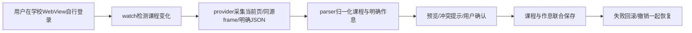

# 导入链、学校扩展与排错

实际 APK 有两条使用相同脚本的路径：Android `AcademicImportActivity` 从 AssetManager 读 `jwimport/provider.js`；Flutter `CoursePageReader` 用 rootBundle 读 `android/jwimport/src/main/assets/jwimport/`。修改后必须确保两处打包都引用这同一来源，不能只更新一个副本。

学校远程页不挂 JavascriptInterface，本地可信预览才挂 `JwImportNative`。Android 使用全局 CookieManager，退出学校时只清当前学校域及访问路径 cookies、销毁父子窗口，防止 sessionStorage 恢复；这是有范围的会话清理，不是每校独立 profile。

采集移除输入框、文本域与无关脚本，保留解析需要的惰性课表数据。只读取已知同源端点与明确学期参数，分页不完整明确拒绝，不猜未知接口。最终确认结果只含标准课程字段，不带原 HTML 或 URL。

## 新增适配

1. 用自己的合成 HTML/JSON 建一个 `tests/*.test.cjs`。先写固定预期：课程名、星期、节次、周次、教师、教室；增加隐藏旧学期、缺周次、分页不全和跨午休等失败样例。
2. 查看 parser 的现有格式识别分支，在可靠特征处新增匹配；保留已有 adapterId/schema/revision。不要仅凭相邻单元格位置猜课程字段。
3. 页面作息有明确节次和起止才返回 periodTimes。缺时间不从总时长均分；作息冲突在宿主预览中保留整套原作息。
4. 先用 `parseImport` 测静态输入，再用 provider 的合成 JSDOM 测采集，最后在用户自己登录的 WebView 验证实际 DOM。自动回放不能写成真实学校网络登录成功。
5. 在 Flutter 宿主保持预览确认、覆盖/撤销与 CourseStore 事务边界；学年/跨年由 AcademicCalendar 统一计算，三视图共享课程与周次状态。

## 接入其它 App

三个 JS 脚本可放入自己的 Android assets/WebView。原生 Activity 参考还依赖 UI/资源/主题，不能把 reference 直接当独立 AAR。标准结果映射到自己的 Course 模型，再联合保存课程和作息。保持信任边界、大小限制和页面退出清理。

无课程通常是尚未加载、非完整学期、iframe跨域、分页未完成或缺明确周次；先看 warnings 与 adapter，不用空结果覆盖旧表。普通文件/截图导入与登录网页作息采集是不同途径。截图 OCR 还有本地色块/行框归位，不等于通用 DOM 解析，也不承诺艺术字识别准确。
